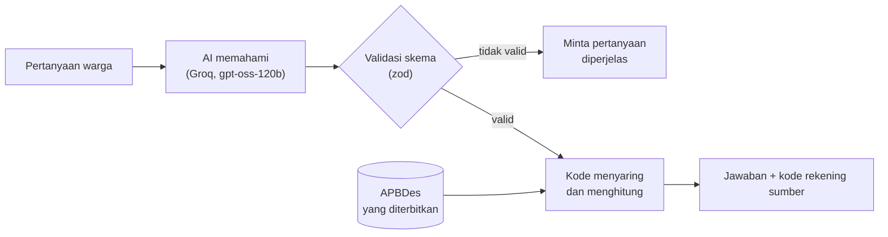
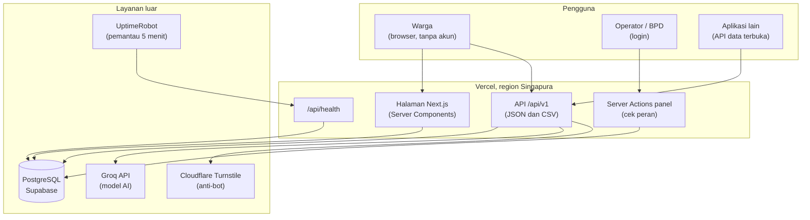

# TanyaDesa

**Tanya anggaran desa dengan bahasa sehari-hari, dapat jawaban yang bisa dicek sendiri.**

TanyaDesa adalah modul *smart governance* untuk ekosistem desa cerdas. Warga bisa menanyakan APBDes (Anggaran Pendapatan dan Belanja Desa) seperti bertanya ke tetangga, misalnya *"Dana buat jalan RT 3 berapa?"*. Jawaban dihitung langsung dari data APBDes resmi dan selalu menyebut kode rekening sumbernya. Warga juga bisa menyampaikan aspirasi yang diteruskan ke perangkat desa dan BPD.

Dibuat untuk **UINIC 8.0 Web Development Competition**.

| | |
|---|---|
| Demo online | https://uinic-tanyadesa.vercel.app |
| Halaman status (uptime) | https://stats.uptimerobot.com/ZMe0W6btlv |
| Cek kesehatan sistem | https://uinic-tanyadesa.vercel.app/api/health |
| Contoh API data terbuka | https://uinic-tanyadesa.vercel.app/api/v1/desa/sukamaju/apbdes/summary |

> Data Desa Sukamaju adalah **data simulasi** untuk demonstrasi, bukan data desa sungguhan. Halaman warga menampilkan label "Simulasi".

---

## Daftar isi

1. [Masalah yang diselesaikan](#masalah-yang-diselesaikan)
2. [Fitur](#fitur)
3. [Prinsip desain AI](#prinsip-desain-ai)
4. [Arsitektur](#arsitektur)
5. [Keamanan dan privasi](#keamanan-dan-privasi)
6. [Ketersediaan](#ketersediaan)
7. [Hasil pengujian](#hasil-pengujian)
8. [Teknologi](#teknologi)
9. [Menjalankan di komputer sendiri](#menjalankan-di-komputer-sendiri)
10. [Struktur folder](#struktur-folder)
11. [Dokumentasi lain](#dokumentasi-lain)

---

## Masalah yang diselesaikan

APBDes wajib diumumkan ke warga, tetapi biasanya hanya berupa baliho atau PDF berisi tabel panjang dengan kode rekening. Warga yang ingin tahu satu hal, misalnya anggaran jalan di RT-nya, harus membaca seluruh tabel atau datang ke kantor desa.

TanyaDesa membuat data yang sama bisa **ditanyakan**, **dicek**, dan **ditanggapi**:

- warga bertanya dengan bahasa sehari-hari dan langsung mendapat angka beserta sumbernya;
- data dibuka sebagai API sehingga bisa dipakai aplikasi lain;
- warga menyampaikan aspirasi dan bisa memantau tanggapannya.

## Fitur

### Untuk warga (tanpa akun)

| Fitur | Alamat | Keterangan |
|---|---|---|
| Ringkasan | `/desa/sukamaju` | Total anggaran, persentase realisasi, sebaran per bidang, dusun, dan sumber dana. |
| Tanya | `/desa/sukamaju/tanya` | Bertanya tentang APBDes. Jawaban menyebut kode rekening sumber. Pertanyaan tentang data pribadi dan di luar APBDes ditolak dengan sopan. |
| Aspirasi | `/desa/sukamaju/aspirasi` | Kirim usulan atau keluhan, boleh tanpa nama. Warga mendapat kode lacak untuk memantau tanggapan. |
| Lacak aspirasi | `/desa/sukamaju/aspirasi/{kode}` | Melihat status dan tanggapan petugas. |

Contoh pertanyaan yang bisa dijawab:

- "Berapa total Dana Desa tahun 2026?"
- "Dana buat jalan RT 3 berapa?"
- "Berapa persen belanja untuk pembangunan?"
- "Kegiatan apa saja yang belum dimulai?"
- "Apa itu SiLPA?" (penjelasan istilah dasar)

### Untuk petugas desa (perlu login di `/masuk`)

| Peran | Bisa melakukan |
|---|---|
| Operator | Mengunggah Excel APBDes, memeriksa hasil baca, menerbitkan atau membatalkan; mengelola aspirasi (kategori, teruskan, tanggapi, tandai selesai). |
| BPD | Membaca dan menanggapi aspirasi. |

Setiap tindakan petugas dicatat di log aktivitas. Versi APBDes lama diarsipkan, tidak dihapus.

Format Excel yang diterima dijelaskan di [docs/FORMAT-EXCEL.md](docs/FORMAT-EXCEL.md).

## Prinsip desain AI

**AI memahami, kode menghitung, setiap jawaban punya sumber.**

Model bahasa bisa menghasilkan jawaban yang terdengar meyakinkan padahal salah. Untuk informasi pemerintahan, jawaban salah lebih merugikan daripada tidak menjawab. Karena itu:

1. **AI hanya memahami pertanyaan.** AI mengubah pertanyaan menjadi struktur data ("niat"): jenis pertanyaan, dusun, RT, bidang, sumber dana, status, kata kunci. Struktur ini divalidasi dengan skema (zod).
2. **Kode yang menghitung.** Penyaringan baris APBDes dan semua penjumlahan dilakukan oleh kode, bukan oleh AI.
3. **Setiap jawaban menyebut sumber.** Kode rekening yang dipakai ditampilkan di bawah jawaban.
4. **Penjelasan istilah ditulis manusia.** Untuk pertanyaan seperti "apa itu APBDes", AI hanya memilih topik; isi penjelasannya teks tetap.
5. **Batas yang jujur.** Pertanyaan di luar APBDes (jadwal layanan, syarat surat) tidak dijawab, melainkan diarahkan ke kantor desa atau menu Aspirasi.



Untuk aspirasi, AI menebak kategori dan menandai pesan yang mungkin spam, kasar, atau berisi ancaman. Keputusan akhir selalu di tangan petugas.

**Hemat kuota.** Pertanyaan yang sama persis untuk APBDes dan prompt yang sama memakai ulang pemahaman yang tersimpan, tanpa memanggil AI lagi; angkanya tetap dihitung ulang dari data. Jika kuota model utama habis, sistem beralih ke model cadangan (gpt-oss-20b).

## Arsitektur



Kode disusun **per fitur** di `src/features/` (`apbdes`, `qa`, `aspiration`, `auth`). Setiap fitur memisahkan:

- `lib/`: logika murni tanpa database, mudah diuji;
- `server/`: akses database dan layanan luar;
- `components/`: tampilan;
- `actions.ts` dan `schemas.ts`: aksi server dan validasi input.

Skema database (12 tabel) ada di [docs/ERD.md](docs/ERD.md).

## Keamanan dan privasi

| Lapisan | Penerapan |
|---|---|
| Autentikasi | Password di-hash dengan bcrypt. Sesi berupa JWT (HS256) di cookie `httpOnly`, `secure`, `sameSite=lax`, berlaku 8 jam. Pesan gagal login dibuat sama untuk email salah dan password salah. |
| Penguncian akun | 5 kali gagal login dalam 15 menit mengunci akun sementara. |
| Otorisasi | Setiap aksi server memeriksa peran (Operator/BPD). Semua query dibatasi `desaId` milik petugas, sehingga petugas satu desa tidak bisa mengubah data desa lain. |
| Validasi input | Semua input API dan form divalidasi dengan zod. |
| Anti-spam | Batas aspirasi: 5 per sesi per jam, 15 per IP per jam, 200 per desa per hari. Batas pertanyaan: 20 per sesi per jam, 500 per desa per hari. |
| Anti-bot | Cloudflare Turnstile di form aspirasi, diverifikasi di server sebelum ada kerja database atau AI. Jika verifikasi gagal atau layanan tidak bisa dihubungi, kiriman ditolak (*fail-closed*). |
| Privasi warga | Aspirasi boleh tanpa nama. Kontak hanya terlihat oleh petugas. IP tidak disimpan, hanya hash SHA-256 dengan garam rahasia. Kode lacak acak 8 karakter. AI menolak pertanyaan tentang data pribadi. |
| Header HTTP | `Content-Security-Policy` (frame-ancestors, base-uri, form-action, object-src), `X-Frame-Options: DENY`, `X-Content-Type-Options: nosniff`, `Referrer-Policy`, `Permissions-Policy`, `Strict-Transport-Security`. |
| Jejak audit | Unggah, terbit, batal, login, dan tindakan aspirasi dicatat di tabel `activity_logs`. |
| Dependensi | Diaudit dengan `npm audit`. Library `xlsx` versi npm yang rentan diganti dengan SheetJS 0.20.3 resmi. |
| Rahasia | Semua kunci di variabel lingkungan, tidak pernah di kode. Lihat [.env.example](.env.example). |

## Ketersediaan

- Dihosting di **Vercel**, region `sin1` (Singapura) agar dekat dengan pengguna di Indonesia.
- **`/api/health`** memeriksa server dan koneksi database, menjawab `200` jika sehat dan `503` jika database tidak terjangkau.
- **UptimeRobot** memeriksa `/api/health` setiap 5 menit; riwayatnya terbuka di [halaman status](https://stats.uptimerobot.com/ZMe0W6btlv).
- Error database dijawab dengan pesan yang aman tanpa membocorkan detail.
- Panggilan AI punya batas waktu, coba ulang otomatis, dan model cadangan.

## Hasil pengujian

**Tes otomatis:** 91 tes (Vitest), menguji pembaca Excel, perhitungan, alur tanya jawab, batas kiriman, sesi, dan lainnya.

```
npm test
```

**Ketepatan AI** diukur dengan 15 pertanyaan memakai model AI sungguhan, termasuk pertanyaan istilah, data pribadi, dan di luar topik ([tests/qa-cases.ts](tests/qa-cases.ts)).

| Versi | Putaran | Tepat |
|---|---|---|
| Akhir (17 Oktober 2026) | 2 | **29 dari 30 (96,7%)**, tanpa kegagalan teknis |
| Model cadangan gpt-oss-20b | 1 | 14 dari 15 |

Kesalahan yang tersisa: pada "Kegiatan apa saja yang belum dimulai?", AI kadang membatasi hanya pada belanja sehingga penyertaan modal BUMDes (pembiayaan) tidak ikut terhitung.

```
npx tsx --env-file=.env scripts/eval-qa.ts
```

## Teknologi

| Bagian | Teknologi |
|---|---|
| Kerangka web | Next.js 16 (App Router, Server Components, Server Actions), React 19, TypeScript |
| Tampilan | Tailwind CSS 4 |
| Database | PostgreSQL (Supabase), Prisma 7 |
| AI | Groq API (OpenAI-compatible), model `openai/gpt-oss-120b`, cadangan `openai/gpt-oss-20b`, output JSON Schema strict |
| Validasi | zod 4 |
| Autentikasi | jose (JWT), bcryptjs |
| Excel | SheetJS 0.20.3 |
| Anti-bot | Cloudflare Turnstile |
| Tes | Vitest |
| Hosting dan pemantauan | Vercel, UptimeRobot |

## Menjalankan di komputer sendiri

### Yang dibutuhkan

- Node.js 20.9 atau lebih baru
- Database PostgreSQL (misalnya proyek gratis di [Supabase](https://supabase.com))
- API key [Groq](https://console.groq.com) (gratis)
- Opsional: kunci [Cloudflare Turnstile](https://www.cloudflare.com/products/turnstile/). Tanpa kunci ini, form aspirasi tetap berjalan tanpa anti-bot.

### Langkah

1. **Unduh kode dan pasang dependensi**

   ```
   git clone <url-repo-ini>
   cd tanyadesa
   npm install
   ```

   `npm install` juga menjalankan `prisma generate` secara otomatis.

2. **Isi variabel lingkungan**

   Salin `.env.example` menjadi `.env`, lalu isi nilainya. Penjelasan tiap variabel ada di dalam file tersebut.

   ```
   cp .env.example .env
   ```

   Untuk Supabase: `DATABASE_URL` memakai koneksi *transaction pooler* (port 6543) untuk aplikasi, `DIRECT_URL` memakai koneksi *session* (port 5432) untuk migrasi.

3. **Buat tabel database**

   ```
   npx prisma migrate deploy
   ```

4. **Isi data awal**

   ```
   npx prisma db seed
   ```

   Membuat Desa Sukamaju (simulasi), 4 dusun, 5 bidang belanja, 8 kategori aspirasi, serta 2 akun demo: `operator@sukamaju.test` dan `bpd@sukamaju.test`. Password keduanya diambil dari `DEMO_PASSWORD` di `.env`.

5. **Impor dan terbitkan APBDes simulasi**

   ```
   npx tsx --env-file=.env scripts/import-apbdes.ts
   ```

6. **Jalankan**

   ```
   npm run dev
   ```

   Buka http://localhost:3000. Panel petugas ada di http://localhost:3000/masuk.

### Perintah lain

| Perintah | Kegunaan |
|---|---|
| `npm test` | Menjalankan tes otomatis |
| `npm run typecheck` | Memeriksa tipe TypeScript |
| `npm run lint` | Memeriksa gaya kode |
| `npm run build` | Build produksi |
| `npx tsx --env-file=.env scripts/eval-qa.ts` | Mengukur ketepatan AI dengan model sungguhan (sekitar 5 menit) |

## Struktur folder

```
prisma/
  schema.prisma        skema database
  migrations/          riwayat perubahan skema
  seed.ts              data awal
scripts/               skrip bantu (impor APBDes, evaluasi AI)
src/
  app/                 halaman dan API (App Router)
    desa/[slug]/       halaman warga: ringkasan, tanya, aspirasi
    masuk/             login petugas
    panel/             panel petugas: APBDes, aspirasi
    api/v1/            API data terbuka
    api/health/        cek kesehatan sistem
  features/
    apbdes/            pembaca Excel, ringkasan, unggah dan terbit
    qa/                tanya jawab: niat AI, perhitungan, penyusunan jawaban
    aspiration/        aspirasi: kirim, kategorisasi AI, panel
    auth/              login, sesi, peran
  lib/                 bagian bersama: database, AI client, keamanan, log
  components/          komponen tampilan bersama
tests/                 data uji dan 15 kasus evaluasi AI
docs/                  dokumentasi tambahan
```

## Dokumentasi lain

- [docs/API.md](docs/API.md): endpoint API, parameter, dan contoh respons
- [docs/ERD.md](docs/ERD.md): diagram relasi database
- [docs/FORMAT-EXCEL.md](docs/FORMAT-EXCEL.md): format Excel APBDes dan prosedur unggah

## Pengembangan berikutnya

- Menjawab pertanyaan dari dokumen desa lain (pengumuman, jadwal layanan, laporan kegiatan) dengan teknik *Retrieval-Augmented Generation*, tetap dengan prinsip yang sama: hanya dari dokumen resmi dan selalu menyebut sumber.
- Membaca langsung file ekspor aplikasi keuangan desa.
- Halaman analitik "pertanyaan warga" untuk perangkat desa.
