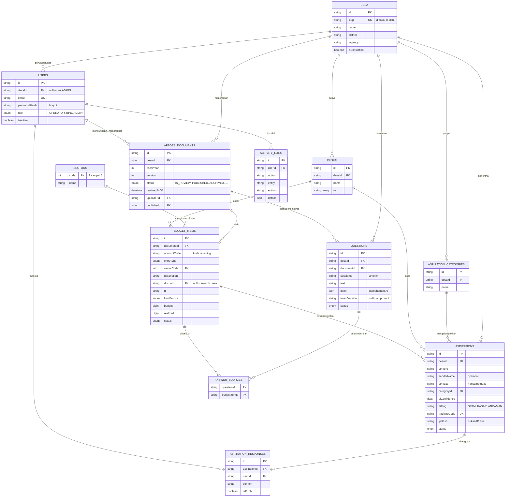

# Skema Database TanyaDesa

PostgreSQL (Supabase), dikelola dengan Prisma. Sumber lengkap: [prisma/schema.prisma](../prisma/schema.prisma).

## Penjelasan tabel

| Tabel | Isi |
|---|---|
| `desa` | Data desa. `isSimulation` menampilkan label "Simulasi" di halaman warga. |
| `dusun` | Dusun dan daftar RT per desa. Dipakai untuk memeriksa nama dusun di Excel. |
| `users` | Akun petugas (Operator, BPD, Admin). Warga tidak perlu akun. |
| `apbdes_documents` | Satu baris per versi APBDes yang diunggah. Hanya satu versi berstatus `PUBLISHED` per desa dan tahun; versi lama menjadi `ARCHIVED`. |
| `sectors` | Lima bidang belanja desa. |
| `budget_items` | Baris anggaran hasil baca Excel. Kode rekening unik per dokumen. |
| `questions` | Pertanyaan warga, pemahaman AI, dan status jawabannya. Dipakai juga untuk batas kiriman dan cache pemahaman. |
| `answer_sources` | Baris anggaran yang dikutip oleh setiap jawaban (banyak ke banyak). |
| `aspiration_categories` | Kategori aspirasi per desa. |
| `aspirations` | Aspirasi warga beserta kategori dan tanda dari AI, kode lacak, dan statusnya. |
| `aspiration_responses` | Tanggapan petugas. `isPublic = false` untuk catatan internal. |
| `activity_logs` | Jejak audit: siapa melakukan apa, terhadap data apa, dan kapan. |

## Indeks penting

| Tabel | Indeks | Untuk |
|---|---|---|
| `budget_items` | `(documentId, accountCode)` unik | Mencegah kode rekening ganda |
| `budget_items` | `(documentId, entryType)`, `(documentId, sectorCode)`, `(documentId, dusunId)` | Penyaringan cepat saat menjawab |
| `questions` | `(sessionId, createdAt)`, `(desaId, createdAt)` | Menghitung batas kiriman |
| `questions` | `(documentId, intentVersion)` | Mencari pemahaman yang bisa dipakai ulang |
| `aspirations` | `(sessionId, createdAt)`, `(ipHash, createdAt)` | Menghitung batas kiriman |
| `aspirations` | `trackingCode` unik | Halaman lacak warga |
